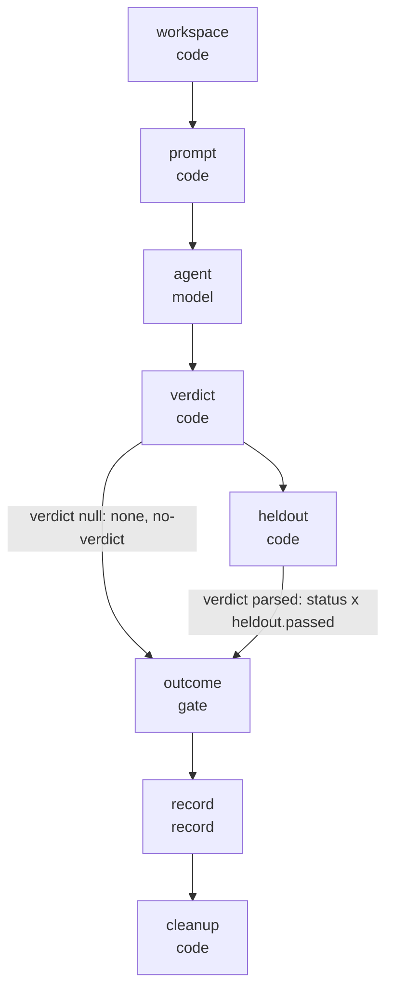
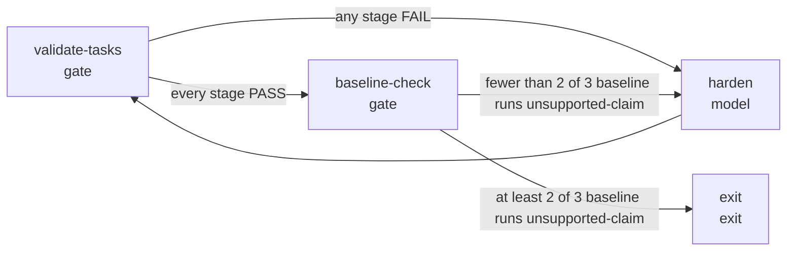

# Agent graph

_Generated by `node graph/render.mjs` from the JSON beside it. Edit the JSON, not this file._

## Per-run workflow

Each run is a prompt-chaining workflow, in the terms of Anthropic's "Building Effective Agents" (December 2024): a fixed sequence of code steps around one model call, with a programmatic gate that turns the claimed status and the held-out result into an outcome. Nodes are labelled by id and kind, and edges by their `when` condition where the flow depends on one.

## Task-authoring loop

Writing a task is an evaluator-optimizer loop in the same vocabulary: the validator and a baseline run evaluate the task, and hardening is the optimizer step that feeds back into validation. The loop exits when the baseline bar is met, at least 2 of 3 baseline runs ending in unsupported-claim.

