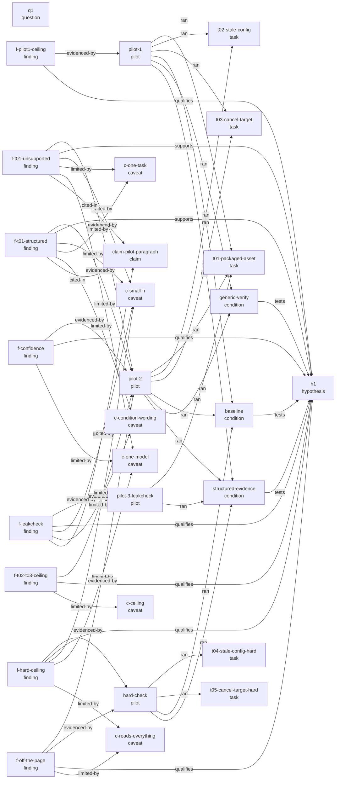

# Research graph

_Generated by `node graph/render.mjs` from the JSON beside it. Edit the JSON, not this file._

This is the provenance graph of the pilot research: which conditions test the hypothesis, which pilots ran which tasks and conditions, which runs each finding rests on, and which findings the application claim cites. It records the evidence behind the evaluation of a prompt-chaining workflow from Anthropic's "Building Effective Agents" (December 2024), and every edge is labelled by its kind.

